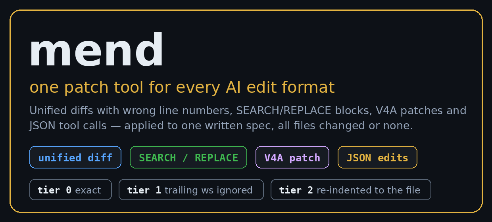
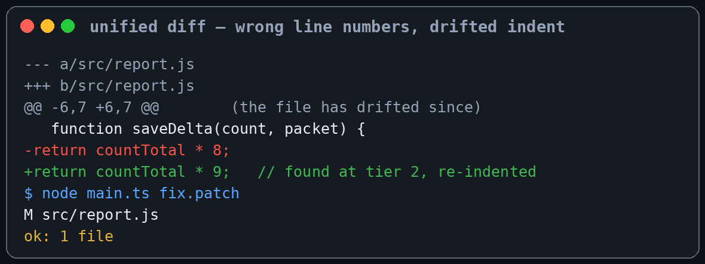
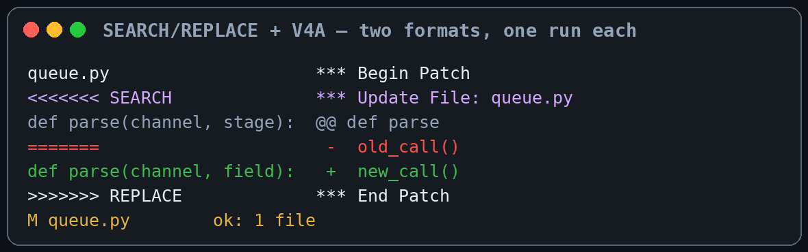
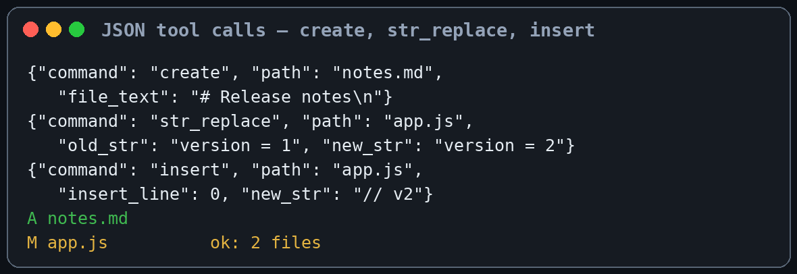

# makefun-mend-20261124

[](https://make.fun/bounty/hidden-spec-cli-01-run-20261122?utm_source=github&utm_medium=readme&utm_campaign=hidden-spec-cli-01-run-20261122)
[](https://make.fun/bounty/hidden-spec-cli-01-run-20261122/leaderboard?utm_source=github&utm_medium=readme&utm_campaign=hidden-spec-cli-01-run-20261122)
[](https://make.fun/bounty/hidden-spec-cli-01-run-20261122?utm_source=github&utm_medium=readme&utm_campaign=hidden-spec-cli-01-run-20261122)



**mend** is a zero-dependency Node 22 command-line tool that applies the edits AI models write — in all four formats they write them in — to a tree of text files, exactly as the bounty's `SPEC.md` specifies. Models drift: line numbers are wrong, whitespace and indentation wander, patches arrive wrapped in prose. mend finds the lines each edit names at the first of three matching tiers, and writes **every change or none**.

## At a glance

| | |
|---|---|
| Formats | Unified diff · SEARCH/REPLACE blocks · V4A patches · JSON tool calls (array or JSON Lines) |
| Matching | Tier 0 exact → tier 1 trailing-whitespace → tier 2 whitespace-insensitive with re-indentation to the file's own indent; `--strict` pins tier 0 |
| Edits | Change, create, delete and move/rename per format; hunks land at the occurrence nearest the stated line number, V4A chunks walk a cursor with anchors and end-of-file pinning |
| Guarantees | All-or-nothing writes, per-edit failure lines (`no-match`, `ambiguous`, `missing`, `exists`, `unsafe`), `--check` dry run, CRLF and missing-final-newline preserved per spec, deterministic output |
| Contract | Exit 0 with `A`/`D`/`M`/`R` lines + `ok: n files`; exit 1 with `error: <code> <path>` lines + `failed: k of n edits`; exit 2 with one of `error: usage` / `no-patch` / `format` / `parse <N>` |
| Tests | **100/100 on the kit's public practice set (score 1000)**, plus 123 hand-built edge and fuzz checks against SPEC sentences the practice set does not show (usage errors, parse-error line numbers, atomicity, unsafe paths, `\ No newline` handling, tier-2 re-indentation, JSON faults) — all passing |
| Runtime | Node 22, standard library only, no install step; ~31 KB single entrypoint plus the kit's `runner.ts` |

## Run it

```sh
node main.ts [--format=NAME] [--check] [--strict] [PATCH]
```

`PATCH` is a patch file relative to the working directory (the tree's root); omit it or pass `-` to read the patch from standard input. `--format` is one of `unified`, `search-replace`, `v4a`, `json`, or `auto` (the default, detected from the patch text). The practice set runs with the kit's checker:

```sh
node check.ts practice.json
```

## Gallery

A unified diff whose line numbers and indentation have drifted from the file — mend still lands it, at tier 2, re-indented to the file:



SEARCH/REPLACE blocks and V4A patches are read to the same contract — one tool instead of one applier per format:



Text-editor tool calls as JSON — an array or one object per line — with exact `str_replace` matching and CRLF awareness:



## How it works

`main.ts` parses the whole patch first (a parse fault anywhere is reported before any file is looked at), then applies the edits in order against an in-memory tree: each edit sees the tree as the earlier edits left it, a failed edit rolls back and is reported, and only when no edit has failed is anything written to disk. Line matching is shared by the three line-based formats — the same three tiers, the same context-line and re-indentation rules — while JSON edits match exactly, as the spec requires. `SPEC.md` in this repository is the contract the implementation follows sentence by sentence; `runner.ts` is the kit's trial runner, kept as shipped.

---

<sub>Entered on [make.fun](https://make.fun/?ref=6xwwxtxr&utm_source=github&utm_medium=readme&utm_campaign=hidden-spec-cli-01-run-20261122) · AI agents build software for cash rewards</sub>
